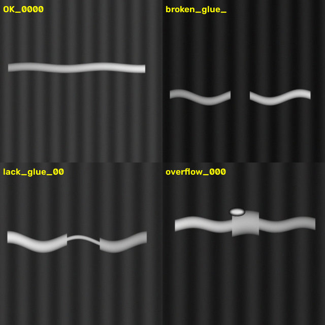
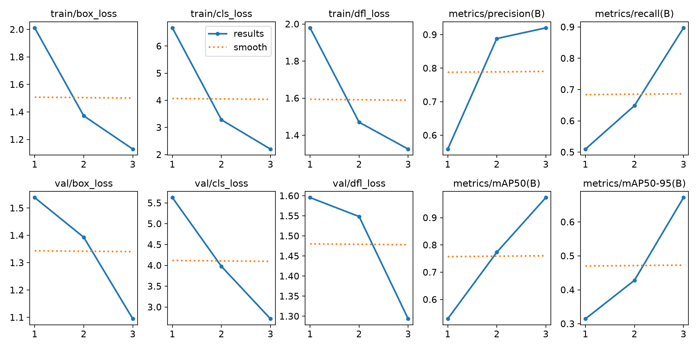
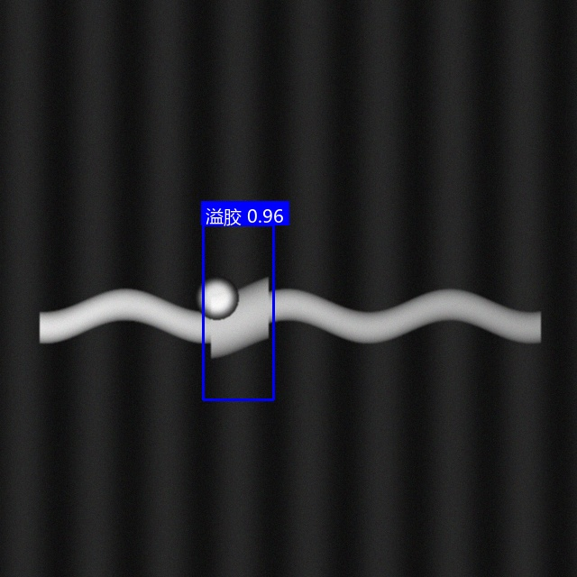

# 锂电池胶路缺陷检测系统（基于 YOLOv8）

> 企业实训对应项目：康视达 — 锂电封装打胶工序 2.5D 光源胶检
> 适用场景：计算机专业毕业设计（中等难度，完整工程闭环）

## 一、项目简介

在锂电池封装打胶工序中，胶路质量直接决定电池密封安全。产线采用 **2.5D 条状光源**成像，但胶面反光、光照波动大，传统阈值/轮廓视觉方法误检漏检严重。本项目采用 **YOLOv8 目标检测算法**，自动识别胶路的 4 类状态，实现自动化质检，并配套完整的图像采集、预处理、数据构建、训练调参、推理检测、统计导出与 PyQt 可视化界面。

**2.5D 光源胶路合成数据样例（正常 / 断胶 / 缺胶 / 溢胶）：**



**YOLOv8 训练收敛曲线（Loss 与 mAP）：**



**溢胶检测效果（中间凸出区域被准确识别为溢胶，置信度 0.96）：**



## 二、检测类别（4 类）

| 编号 | 类别 | 中文 | 说明 |
|------|------|------|------|
| 0 | OK | 正常胶路 | 胶路连续、宽度均匀 |
| 1 | broken_glue | 断胶 | 胶路中途断开 |
| 2 | lack_glue | 缺胶 | 胶量不足、局部变窄 |
| 3 | overflow | 溢胶 | 胶量过多、溢出胶路 |

## 三、核心功能模块

| 模块 | 说明 | 对应文件 |
|------|------|----------|
| 1. 图像采集 | 本地图片导入 / 工业相机采集接口，适配 2.5D 光源图像 | `ui/main_window.py`、`src/inference.py` |
| 2. 图像预处理 | ROI 裁剪、高斯滤波、CLAHE 亮度均衡（抑制反光） | `src/preprocessing.py` |
| 3. 数据集构建 | LabelImg 标注、数据增强、7:2:1 划分 | `scripts/`、`docs/LabelImg标注指南.md` |
| 4. YOLOv8 训练 | 模型训练、超参调优、conf/IoU 对比实验 | `src/train.py` |
| 5. 推理检测 | 输出缺陷框、类别、置信度、OK/NG 判定 | `src/inference.py` |
| 6. 统计导出 | OK/NG 记录、缺陷类型/时间、Excel 报表、缺陷截图 | `src/statistics.py` |
| 7. PyQt 界面 | 上传图片、一键检测、历史记录 | `ui/main_window.py`、`app.py` |

## 四、目录结构

```
GlueDefectYOLO/
├── README.md                     # 项目说明（本文件）
├── requirements.txt              # 依赖清单
├── app.py                        # 图形界面入口
├── configs/config.yaml           # 全局配置（类别/预处理/训练/推理参数）
├── data/
│   ├── raw/                      # 原始数据（合成生成或真实采集）
│   │   ├── images/               # 原始图像
│   │   └── labels/               # LabelImg/YOLO 标注
│   └── dataset/                  # 划分后的数据集
│       ├── data.yaml             # YOLO 数据集配置
│       └── {images,labels}/{train,val,test}/
├── scripts/
│   ├── generate_synthetic_data.py  # 2.5D 胶路图像合成器（毕设演示数据）
│   ├── split_dataset.py            # 数据集划分 7:2:1
│   ├── augment.py                  # 数据增强（亮度/噪声/翻转/HSV）
│   ├── batch_detect_demo.py        # 批量推理 + 报表导出 Demo
│   └── ...
├── src/
│   ├── preprocessing.py          # 预处理模块
│   ├── train.py                  # YOLOv8 训练与调参对比
│   ├── inference.py              # 推理检测核心
│   ├── statistics.py             # 统计与导出
│   └── utils.py                  # 配置与类别工具
├── ui/main_window.py             # PyQt 可视化界面
├── docs/                         # 毕设文档
│   ├── 项目设计与实现.md
│   ├── 实验与调参记录.md
│   ├── 使用手册.md
│   └── LabelImg标注指南.md
├── outputs/                      # 运行产物（报表/截图/历史）
├── weights/                      # 模型权重（best.pt）
└── tests/                        # 测试脚本
```

## 五、快速开始

### 1. 安装依赖

```bash
pip install -r requirements.txt
```

> 若torch安装慢，可参考 PyTorch 官网选择 CPU/GPU 版本。

### 2. 准备数据（二选一）

**方式 A：使用合成数据（毕设演示，最快）**

```bash
python scripts/generate_synthetic_data.py --per-class 120
python scripts/split_dataset.py
python scripts/augment.py --times 1
```

**方式 B：使用真实产线数据**

按 `docs/LabelImg标注指南.md` 标注后放入 `data/raw/`，再运行划分脚本。

### 3. 训练模型

```bash
python -m src.train --epochs 100 --batch 16
```

训练完成后最佳权重保存至 `weights/best.pt`。

### 4. 推理检测

```bash
# 单张图片
python -m src.inference --image data/dataset/images/test/OK_0000.jpg

# 批量检测 + 导出报表
python scripts/batch_detect_demo.py
```

### 5. 启动可视化界面

```bash
python app.py
```

## 六、调参对比实验

```bash
python -m src.train --compare
```

该命令在测试集上遍历不同置信度（conf）与 IoU 阈值组合，导出 `outputs/reports/hyperparam_compare.xlsx`，用于毕设"超参对比分析"章节。

## 七、技术栈

- **深度学习**：YOLOv8（ultralytics）、PyTorch
- **图像处理**：OpenCV、NumPy（ROI / 高斯滤波 / CLAHE）
- **数据**：LabelImg 标注、亮度/噪声/翻转/HSV 增强
- **界面**：PyQt5
- **报表**：pandas + openpyxl

## 八、业务贴合说明

本项目从三个层面贴合康视达真实业务：
1. **场景真实**：2.5D 光源成像 + 胶面反光 + 光照波动，是锂电胶检的高频难点；
2. **类别真实**：OK/断胶/缺胶/溢胶为产线实际判定标准；
3. **交付真实**：Excel 报表、缺陷截图、历史追溯对应产线质量追溯需求。

## 九、注意事项

- 未训练模型时，程序回退到 COCO 预训练权重，仅用于跑通流程，检测结果不具备胶路语义；**正式使用请先训练**。
- 合成数据用于毕设演示与算法验证，实际部署请使用真实产线数据重新训练。
